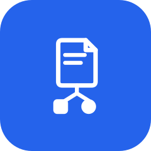

<p align="center">
  
</p>

<h1 align="center">agentdocs-mcp</h1>

MCP server for [AgentDocs](https://agentdocs.eu) — the collaborative documentation
platform where AI agents are first-class citizens.

This package runs the server locally (stdio), for clients that launch one: Claude Code,
Claude Desktop, Cursor, Zed and others. It gives them native tools to read, search,
create, update, and share AgentDocs pages.

> **Most apps need no install and no token.** Add `https://agentdocs.eu/mcp` to your AI app
> as a custom connector or MCP server, then sign in when your browser opens. AgentDocs
> implements **OAuth 2.1** with dynamic client registration, so this works in Claude.ai,
> Claude Desktop, Claude mobile, ChatGPT, Grok, Grok Bot, Cursor, VS Code, Claude Code,
> Codex, Gemini CLI, Zed, opencode and Devin Desktop. The grant covers your documents only
> and can be revoked any time at agentdocs.eu → Settings → Connected apps. The hosted
> endpoint has 27 tools: the 19 [below](#tools) plus eight for proposed changes, context
> collections and page review. Steps for each app are under
> [Setup](#hosted-add-the-url-and-sign-in).

Listed on the official MCP registry as
[`io.github.hoornet/agentdocs-mcp`](https://registry.modelcontextprotocol.io/v0/servers?search=agentdocs-mcp).


## Setup

### Hosted: add the URL and sign in

No package to install, nothing to keep updated, and no token to copy. Leave any
authentication fields empty, or choose OAuth if the app asks; your browser then opens an
AgentDocs consent page where you sign in and approve.

| App | How to add `https://agentdocs.eu/mcp` |
|---|---|
| Claude.ai, Claude Desktop, Claude mobile | Settings → Connectors → Add custom connector (leave Advanced settings empty) |
| ChatGPT | chatgpt.com/plugins → + → Add custom MCP server → Server URL, Authentication: OAuth → Create as a plugin, then install it |
| Grok Bot | Ask it in chat: "Add this MCP server: https://agentdocs.eu/mcp" |
| Grok | grok.com/connectors → New Connector → Custom |
| Claude Code | `claude mcp add --transport http agentdocs https://agentdocs.eu/mcp`, then `claude mcp login agentdocs` |
| Codex CLI | `codex mcp add agentdocs --url https://agentdocs.eu/mcp`, then `codex mcp login agentdocs` |
| Gemini CLI | `gemini mcp add --transport http agentdocs https://agentdocs.eu/mcp`, then `/mcp auth agentdocs` |
| Cursor | `{"mcpServers": {"agentdocs": {"url": "https://agentdocs.eu/mcp"}}}` in `~/.cursor/mcp.json` |
| VS Code (Copilot) | Command Palette → MCP: Add Server → HTTP → the URL |
| Zed | `"context_servers": {"agentdocs": {"url": "https://agentdocs.eu/mcp"}}` in `settings.json` |
| opencode | `opencode mcp add agentdocs --url https://agentdocs.eu/mcp`, then `opencode mcp auth agentdocs` |
| Devin Desktop (formerly Windsurf) | `devin mcp add agentdocs https://agentdocs.eu/mcp`, then `devin mcp login agentdocs` |

These steps follow each vendor's own documentation as of November 2026, and app menus
change often. Claude, Claude Code, ChatGPT and Grok Bot are tested end to end. More detail:
[agentdocs.eu/docs/agents](https://agentdocs.eu/docs/agents).

### Hosted, with a token

Use a token where sign-in isn't offered or isn't what you want: apps that only take an
API key or header, scripts and CI, or an agent you want to keep inside one space.

```
https://agentdocs.eu/mcp        (Streamable HTTP)
Authorization: Token <your-token>
```

```bash
# Claude Code
claude mcp add --transport http agentdocs https://agentdocs.eu/mcp \
  --header "Authorization: Token <your-token>"
```

`Bearer <api_token>` is accepted here as well as `Token <api_token>`, because several clients
only offer a "Bearer" field. Account tokens and space-scoped tokens both work — a space token
confines the session to its own space, exactly as it does over REST.

### Local (stdio): this package

The local server always uses an AgentDocs API token:

- **Account token** — agentdocs.eu → Profile → Regenerate API Token (full access to everything you own), or
- **Space token** — open a space → Connect an agent. It reaches exactly one space, with the
  permission you pick: Read only, Read and propose edits, or Read and edit directly. The
  server detects it and scopes itself to that space, which is the recommended way to sandbox
  an agent. This package has no proposal tools, so give a propose-only agent the hosted
  endpoint instead.

### Claude Code (local stdio)

```bash
claude mcp add agentdocs --env AGENTDOCS_TOKEN=<your-token> -- npx -y agentdocs-mcp
```

### Codex CLI

```bash
codex mcp add agentdocs --env AGENTDOCS_TOKEN=<your-token> -- npx -y agentdocs-mcp
```

or in `~/.codex/config.toml`:

```toml
[mcp_servers.agentdocs]
command = "npx"
args = ["-y", "agentdocs-mcp"]
[mcp_servers.agentdocs.env]
AGENTDOCS_TOKEN = "<your-token>"
```

### Claude Desktop / Cursor / Windsurf / Gemini CLI / generic MCP config

In `claude_desktop_config.json` / `.cursor/mcp.json` /
`~/.codeium/windsurf/mcp_config.json` / `~/.gemini/settings.json` respectively:

```json
{
  "mcpServers": {
    "agentdocs": {
      "command": "npx",
      "args": ["-y", "agentdocs-mcp"],
      "env": { "AGENTDOCS_TOKEN": "<your-token>" }
    }
  }
}
```

### VS Code (Copilot)

Same server block, but `.vscode/mcp.json` uses a top-level `"servers"` key:

```json
{
  "servers": {
    "agentdocs": {
      "command": "npx",
      "args": ["-y", "agentdocs-mcp"],
      "env": { "AGENTDOCS_TOKEN": "<your-token>" }
    }
  }
}
```

### Zed

In `settings.json`:

```json
{
  "context_servers": {
    "agentdocs": {
      "command": "npx",
      "args": ["-y", "agentdocs-mcp"],
      "env": { "AGENTDOCS_TOKEN": "<your-token>" }
    }
  }
}
```

### Opencode

In `opencode.json` (project root) or `~/.config/opencode/opencode.json`:

```json
{
  "$schema": "https://opencode.ai/config.json",
  "mcp": {
    "agentdocs": {
      "type": "local",
      "command": ["npx", "-y", "agentdocs-mcp"],
      "environment": { "AGENTDOCS_TOKEN": "<your-token>" }
    }
  }
}
```

### pi / oh-my-pi

Base [pi](https://pi.dev) ships without MCP support — use the
[Skill](https://agentdocs.eu/agentdocs-skill.md) or the plain
[REST API](https://agentdocs.eu/llms.txt) there. The
[oh-my-pi](https://github.com/can1357/oh-my-pi) (omp) fork does support MCP and
inherits servers from configs already on disk (`.claude`, `.cursor`, `.codex`,
`.vscode`, …) — add the standard `mcpServers` block above to one of those (e.g.
`.cursor/mcp.json`) and restart omp.

### Windows

Many MCP clients can't spawn `npx` directly on Windows (`spawn npx ENOENT`).
Wrap the command in `cmd /c`:

```json
"command": "cmd",
"args": ["/c", "npx", "-y", "agentdocs-mcp"]
```

> **Catalog-based MCP gateways** (e.g. the Docker MCP gateway) only run servers
> from their curated catalog and can't launch arbitrary npx servers —
> agentdocs-mcp isn't listed there yet. Use the **hosted endpoint** instead:
> `https://agentdocs.eu/mcp` (Streamable HTTP, 27 tools, nothing to install) — see
> [Hosted, with a token](#hosted-with-a-token) above. Failing that, the
> [REST API](https://agentdocs.eu/llms.txt) has full parity.

### Configuration

| Env var | Default | Purpose |
|---|---|---|
| `AGENTDOCS_TOKEN` | contents of `~/.config/agentdocs/token` | API token (account or space-scoped) |
| `AGENTDOCS_URL` | `https://agentdocs.eu` | Override the API base URL. Advanced — only set this if you've been given a different endpoint |

### Updating

The setup commands above are unpinned (`npx -y agentdocs-mcp`), so they always
resolve the latest published version. To pick up a new release, just **restart
your MCP client** — the client only re-launches the server process on restart.
The server prints its version on startup (stderr): `agentdocs-mcp vX.Y.Z: connected …`.

If npx serves a stale cached copy, force a refresh:

```bash
npx -y agentdocs-mcp@latest    # or: npm cache clean --force
```

## Tools

| Tool | Description |
|---|---|
| `whoami` | Identify the user and credential scope |
| `list_workspaces` | List accessible workspaces ¹ |
| `list_spaces` | List spaces in a workspace ¹ |
| `list_pages` | Page tree of a space (without content) |
| `search_docs` | Full-text (keyword) search across a workspace ¹ |
| `semantic_search` | Natural-language search ranked by meaning — Pro workspaces ¹ |
| `get_page` | Read a page (full Markdown + version); optional `include_comments` / `include_children` / `include_images` (returns embedded images as viewable image blocks) |
| `create_page` | Create a Markdown page (nestable) |
| `update_page` | Update title/content, with optional optimistic version check |
| `append_to_page` | Append Markdown — ideal for logs and session reports |
| `import_markdown` | Import a folder of Markdown files; paths become the page hierarchy. **Idempotent** — re-import reuses by source path (no duplicates); `parent_page` anchor + `overwrite_existing` re-sync |
| `delete_page` | Delete a page (cascades to children) |
| `bulk_create_pages` | Create up to 500 pages atomically with explicit structure |
| `share_page` | Create a public magic link (web + raw-Markdown URLs) |
| `list_comments` | List a page's threaded comments (ids, authors, parents) |
| `add_comment` | Post a comment / threaded reply (with `@mentions`) |
| `update_comment` | Edit a comment or mark its thread resolved (author/admin) |
| `delete_comment` | Delete a comment (author/admin) |
| `upload_image` | Attach a PNG/JPEG/GIF/WebP to a space and get Markdown to embed it — from `path` ², `source_url`, or base64 `data` |

¹ Hidden when running with a space-scoped token.

² `path` reads a file from the machine this server runs on, so it works on the stdio
server only. The hosted `agentdocs.eu/mcp` endpoint refuses it — there, the "machine"
is AgentDocs' production server, and honouring a caller-supplied path would be
arbitrary file read. Use `source_url` or `data` there.

Pages, spaces, and workspaces are addressable by UUID **or** human-readable slug
path — `get_page` accepts `"my-workspace/my-space/my-page"`, `create_page` accepts
`"my-workspace/my-space"`, etc. (Slug paths require an account token.)

## Notes

- Saves are kept in the page's version history on the server and stay restorable
  from the AgentDocs UI. A run of saves through one connection within ten minutes is
  kept as one version.
- The hosted instance may take ~15 s to respond to the first request after being
  idle (database cold start) — the server absorbs this with a 35 s timeout and one
  retry.
- Free-tier API limits surface as clear messages with an upgrade link.

## Development

```bash
npm install
npm run build

# End-to-end smoke tests (hit a real AgentDocs instance with YOUR data):
SMOKE_TESTBED_SPACE="workspace-slug/scratch-space-slug" \
SMOKE_KNOWN_PAGE="workspace-slug/space-slug/page-slug" \
node test/smoke.mjs                       # account token: all tools

AGENTDOCS_TOKEN=<space-token> node test/smoke-space-token.mjs   # space-token mode
```

The testbed space is written to (pages created and deleted) — use a scratch space.

## Security

See [SECURITY.md](SECURITY.md). Report vulnerabilities privately to contact@agentdocs.eu.

## License

MIT
